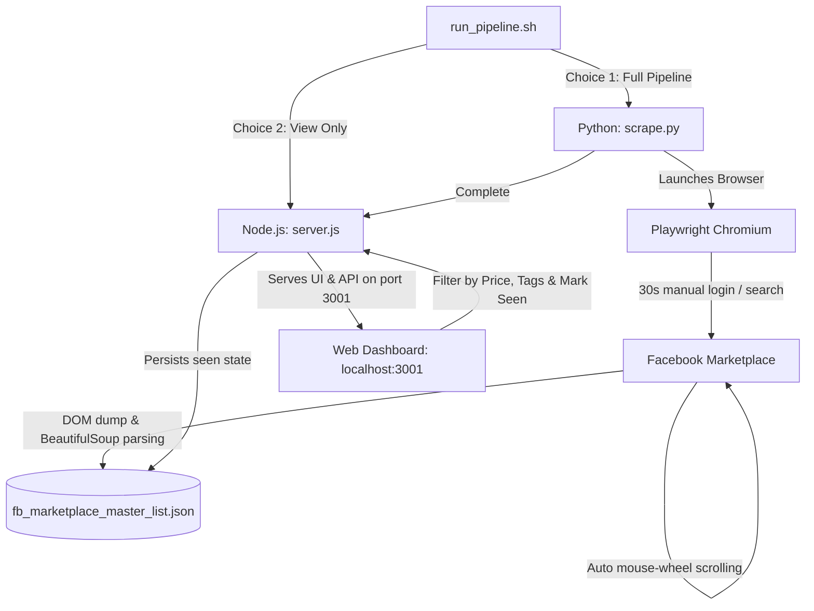

# Facebook Marketplace Scraper & Viewer

A lightweight automation and listing viewer for Facebook Marketplace. It uses **Playwright** and **BeautifulSoup** in Python to scrape listings into a local JSON database, and an **Express.js** web interface to filter, search, and track seen listings.

---

## 🏗️ Architecture Overview



---

## ⚡ Quick Start

### 1. Prerequisites
- **Node.js** (v18 or higher)
- **Python** (3.8 or higher)

### 2. Installation

Clone or open the repository folder, then install dependencies:

```bash
# 1. Make the pipeline runner executable
chmod +x run_pipeline.sh

# 2. Setup Python virtual environment & dependencies
python3 -m venv .venv
source .venv/bin/activate
pip install -r requirements.txt
playwright install chromium

# 3. Setup Node.js dependencies
npm install
```

### 3. Running the Application

Simply execute the pipeline script:

```bash
./run_pipeline.sh
```

You will see an interactive prompt:
- **`1` (Full Pipeline):** Launches the browser scraper, scrolls and extracts listings, then launches the local dashboard.
- **`2` (View Only):** Skips scraping and immediately starts the dashboard using previously scraped listings.

To stop the server and exit, type `x` and press Enter in the terminal.

---

## 🔍 How It Works

### 1. Scraping Mechanism (`scrape.py`)
- **Non-Headless Playwright:** Launches a visible Chromium window so you can interact with Facebook.
- **30-Second Login & Search Window:** Opens `https://www.facebook.com/marketplace` and waits for 30 seconds. You can log in (if needed) and type your search query into Marketplace's search input.
- **Automated Scrolling:** Executes `scroll_down_hard()` using `page.mouse.wheel(0, scroll_amount)` with randomized pixel jumps (3,000–5,000px) and random pauses (1.5–2.5s) for up to 3 minutes (`SEARCHTIME = 180s`) to trigger Facebook's infinite scroll.
- **In-Memory Parsing:** Captures the full rendered DOM and parses it with BeautifulSoup:
  - Reads your active search term from Facebook's search input.
  - Finds all listing anchors matching `/marketplace/item/`.
  - Safely extracts the price, title, and location.
- **Deduplication & Storage:** Extracts unique item IDs (regex `/item/(\d+)`) and merges new items into `fb_marketplace_master_list.json` without overwriting existing entries or losing `seen` status.

### 2. Web Dashboard & Screen Manipulation (`server.js` + `public/`)
- **Backend API:** An Express server provides:
  - `GET /api/listings`: Loads current listings from JSON (or returns `[]` if none exist yet).
  - `POST /api/mark-seen`: Persistently marks a listing as `seen: true` when you click "View".
- **Dynamic Buttons & Filters:**
  - **Search Tag Buttons:** Dynamically creates filter buttons from previous searches stored in the database. Clicking a tag toggles active/inactive state and filters listings immediately.
  - **Title Keyword Tag Chips:** Type any keyword into the tag filter and press Enter. Clickable chips appear to narrow results (e.g., specific brands or models). Click any chip to remove it.
  - **Price Range Filter:** Set minimum and maximum price thresholds.
  - **Shipping Exclusion:** Automatically excludes listings marked with *"Ships to you"*.
  - **Seen State Tracking:** Clicking "View" opens the Facebook listing in a new tab, grays out the row in the table, and sends a background POST request to persist the seen status.

---

## ⚙️ Manual / Custom Execution

You can run each component independently without the bash script:

### Run Scraper Alone:
```bash
source .venv/bin/activate
python3 scrape.py
```

### Run Web Viewer Alone:
```bash
# Starts on default port 3001 (or set custom PORT)
PORT=3001 node server.js
```
Then visit `http://localhost:3001` in your browser.

---

## 📁 Project Structure

```text
├── fb_marketplace_master_list.json # Local database of scraped listings (auto-generated)
├── package.json                    # Node dependencies (Express)
├── requirements.txt                # Python dependencies (Playwright, BeautifulSoup4)
├── run_pipeline.sh                 # Orchestrator script to run scraper & web server
├── scrape.py                       # Playwright scraper script
├── server.js                       # Express backend server
└── public/
    ├── index.html                  # Dashboard HTML markup
    ├── listings.js                 # Frontend filtering, tag handling & DOM manipulation
    └── styles.css                  # UI styling and .seen listing highlights
```
